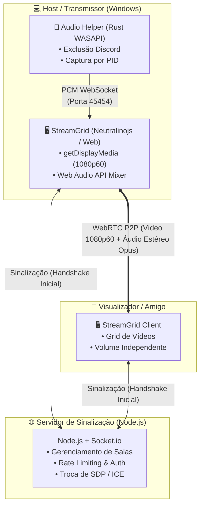

# 🖥️ StreamGrid — Multi-Screenshare P2P (1080p 60FPS)

<p align="center">
  
</p>

<p align="center">
  <strong>Compartilhamento de tela simultâneo de ultra-baixa latência com isolamento de áudio por WASAPI para jogos, filmes e colaboração.</strong>
</p>

<p align="center">
  
  
  
  
  
</p>

---

## 📖 Visão Geral

O **StreamGrid** é uma aplicação completa de compartilhamento de tela ponto-a-ponto (P2P via WebRTC), projetada especificamente para quem deseja assistir transmissões mútuas com fluidez de 60FPS e delay praticamente nulo (< 100ms em rede local / redes diretas).

Ideal para casais e amigos assistirem jogos ou séries ao mesmo tempo, permitindo que **todos na sala compartilhem a tela simultaneamente em uma grade inteligente**, sem intermediários de vídeo centralizados consumindo largura de banda.

---

## ✨ Principais Funcionalidades

### 🚀 Performance & Vídeo
* **P2P Direto via WebRTC:** Conexão ponto a ponto direta entre os navegadores/aplicativos após a sinalização inicial, garantindo a menor latência possível.
* **1080p 60FPS com SDP Otimizado:** Negociação de SDP customizada para máxima taxa de bitrate de vídeo e priorização de perfil de alta fidelidade (`b=AS:8000`, `max-fr=60`).
* **Multi-Transmissão Simultânea (Grade Dinâmica):** Vários membros podem transmitir ao mesmo tempo. A grade adapta automaticamente o layout (1 tela, split horizontal/vertical, grade 2x2, etc.).
* **Controles por Transmissão:** Controle de volume independente por tela, modo tela cheia e alternador de perfil de qualidade (*Fluido* vs *Nitidez*).

### 🎧 Motor de Áudio WASAPI Exclusivo (Rust)
Desenvolvido em **Rust** utilizando as APIs de baixo nível do Windows (**WASAPI Loopback Process Isolation**):
* **Filtro Anti-Eco do Discord (Zero Configuração):** Captura todo o som do computador (jogos, YouTube, Spotify) e **exclui automaticamente a chamada de voz do Discord**. Você e seus amigos não ouvem o próprio eco na stream, sem precisar de cabos de áudio virtuais (VB-Audio Cable).
* **Captura por Aplicativo Específico:** Permite isolar e transmitir apenas o áudio de uma janela/jogo selecionado.
* **Ciclo de Vida Automático & Watchdog:** O assistente de áudio em segundo plano é iniciado e encerrado automaticamente junto com a aplicação, com watchdog atrelado ao PID do processo pai.

### 🛡️ Salas & Segurança
* **Salas Privadas e Senhas:** Crie salas com códigos amigáveis ou gere códigos aleatórios protegidos por senha com hash SHA-256 e salting.
* **Proteção Anti-Brute-Force & Rate Limiting:** Limitação estrita de tentativas de autenticação e mitigação de flood de sinalização WebSockets.
* **Prevenção de Ataques:** Sanitização de entradas contra DOM XSS, proteção contra impersonação de stream e desconexão forçada de sessões duplicadas.

### 💻 Multiplataforma (App Desktop & Navegador)
* **Desktop Nativo (Windows):** Pacote ultra-leve compilado com [Neutralinojs](https://neutralino.js.org/) (~15MB de consumo de memória vs. ~200MB+ de Electron).
* **Acesso Web Universal:** Pode ser acessado diretamente pelo Chrome ou Edge em qualquer máquina na rede local.

---

## 🏗️ Arquitetura do Sistema



---

## 📁 Estrutura de Pastas

```text
screensharep2p/
├── bin/                          # Binários compilados do audio helper
│   └── streamgrid-audio-helper.exe
├── public/                       # Frontend da aplicação
│   ├── index.html                # Interface de salas e visualizador de streams
│   ├── style.css                 # Estilos modernos (Dark/Light mode, grid responsiva)
│   ├── app.js                    # Lógica WebRTC, controles e integração WASAPI
│   └── js/                       # Dependências estáticas (Neutralino, Socket.io)
├── tools/
│   └── audio-helper/             # Código-fonte do motor de áudio nativo em Rust
│       ├── Cargo.toml
│       └── src/main.rs           # Captura de loopback WASAPI com isolamento de processo
├── test/                         # Bateria de testes automatizados
│   ├── fuzz-crash-test.js        # Teste de robustez contra payloads maliciosos
│   ├── sdp-optimization.test.js  # Teste unitário de manipulação de SDP
│   ├── ip-rate-limit.test.js     # Teste de mitigação de força bruta
│   └── audio-helper-token.test.js# Teste de ciclo de vida de tokens
├── server.js                     # Servidor Node.js de sinalização e estáticos
├── neutralino.config.json        # Configuração da janela do app desktop
└── package.json                  # Scripts e dependências do projeto
```

---

## 🚀 Como Executar

### Pré-requisitos
* [Node.js](https://nodejs.org/) (versão 18 ou superior)
* [Rust & Cargo](https://rustup.rs/) *(apenas se for recompilar o `audio-helper`)*

### 1. Clonar e Instalar Dependências
```bash
git clone https://github.com/Pedrosasouza/screenshare-p2p.git
cd screenshare-p2p
npm install
```

### 2. Iniciar o Servidor de Sinalização
```bash
npm start
```
Para modo de desenvolvimento com recarregamento automático:
```bash
npm run dev
```

O servidor exibirá o endereço local e o IP da sua rede:
```text
==================================================
  🖥️ StreamGrid Multi-Screenshare rodando!
  Local:   http://localhost:3000
  Rede:    http://192.168.x.x:3000
==================================================
```
Basta abrir o link no navegador no seu computador e enviar o link da rede para quem estiver conectado com você.

---

## 📦 Como Compilar a Versão Desktop para Windows

O projeto inclui um script que compila o assistente de áudio em Rust no modo `release`, empacota os arquivos com o Neutralinojs e gera um pacote `.zip` portátil pronto para uso:

```bash
npm run build-windows
```

O artefato final estará disponível em:
```text
dist/StreamGrid-Windows.zip
```

---

## 🧪 Testes Automatizados

O repositório conta com suites de teste para garantir a segurança e estabilidade da sinalização e manipulação SDP:

```bash
npm test
```

Os testes cobrem:
* **Fuzzing & Crash Tests:** Garante que o servidor não sofra crash com mensagens WebSocket corrompidas ou tipos inesperados.
* **Otimização de SDP:** Validação de injeção correta de bitrates e estéreo Opus.
* **Rate Limiting:** Validação do bloqueio temporário após tentativas consecutivas inválidas de senha.
* **Token Lifecycle:** Garantia de persistência e validação dos tokens de autenticação local.

---

## ⚙️ Tecnologias Utilizadas

* **Linguagens:** JavaScript (ES6+), Rust (Edition 2021), HTML5, CSS3.
* **WebRTC & Streaming:** RTCPeerConnection, Web Audio API, Opus Codec.
* **Sinalização:** Node.js, Express, Socket.io.
* **Nativo / Sistema:** WASAPI (Windows Audio Session API), Tokio, Windows API (`windows-rs`).
* **Desktop:** Neutralinojs v5.6.

---

## 📄 Licença

Distribuído sob a licença **MIT**. Consulte o arquivo [LICENSE](LICENSE) para obter mais informações.

---

<p align="center">
  Desenvolvido por <strong><a href="https://github.com/Pedrosasouza">Pedro Souza</a></strong>
</p>
