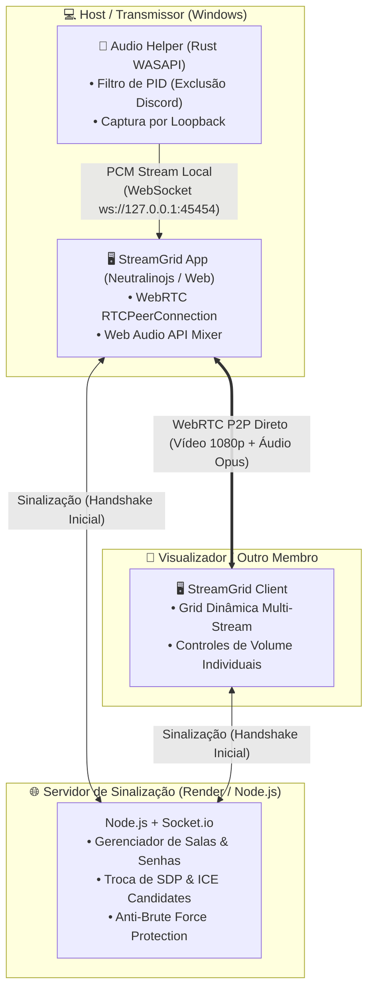

# 🖥️ StreamGrid — Multi-Screen Sharing over WebRTC

<p align="center">
  <a href="https://screenshare-p2p.onrender.com" target="_blank">
    
  </a>
</p>

<p align="center">
  <strong>Compartilhamento simultâneo de múltiplas telas em tempo real com isolamento nativo de áudio para Windows.</strong>
</p>

<p align="center">
  <a href="https://screenshare-p2p.onrender.com">
    
  </a>
</p>

<p align="center">
  
  
  
  
  
</p>

---

## 📌 O que é o StreamGrid?

O **StreamGrid** é uma aplicação de compartilhamento de tela projetada para resolver duas limitações frequentes em chamadas convencionais (Discord, Google Meet, Teams):

1. **Compartilhamento restrito a uma única pessoa:** No StreamGrid, **múltiplos participantes podem transmitir suas telas ao mesmo tempo**, organizadas em uma grade de visualização responsiva com controles de volume independentes.
2. **O problema do eco de áudio (Loopback):** Ao transmitir o som do PC durante uma chamada com amigos, a voz dos próprios participantes costuma vazar na transmissão, gerando eco infinito. Na versão Desktop do StreamGrid, um motor nativo filtra e **exclui o áudio da chamada do Discord** sem depender de drivers ou cabos virtuais adicionais.

> 🚀 **Experimente agora mesmo:** A versão web da aplicação está hospedada e disponível para testes em:  
> **👉 [https://screenshare-p2p.onrender.com](https://screenshare-p2p.onrender.com)**

---

## ⚖️ Versão Web vs. Versão Desktop (Importante)

Devido às políticas de segurança e sandbox dos navegadores modernos (`getDisplayMedia`), certas operações de baixo nível de áudio do sistema operacional só são possíveis no aplicativo desktop.

| Recurso | Versão Web (Navegador) | Versão Desktop (Windows) |
| :--- | :---: | :---: |
| **Acesso Imediato sem Instalação** | ✅ Sim (Link direto no Render) | ⚙️ Requer download/compilação |
| **Visualização Multi-Telas em Grade** | ✅ Sim | ✅ Sim |
| **Transmissão de Vídeo (1080p 60FPS)** | ✅ Sim | ✅ Sim |
| **Áudio de Abas / Dispositivo Padrão** | ✅ Sim (nativo do navegador) | ✅ Sim |
| **Filtro Anti-Eco (Transmitir PC sem Discord)** | ❌ *Indisponível no browser* | ✅ **Exclusivo Desktop (Rust WASAPI)** |
| **Captura de Áudio Isolada por Janela/Jogo** | ❌ *Indisponível no browser* | ✅ **Exclusivo Desktop (Rust WASAPI)** |

> [!IMPORTANT]
> **Ressalva de Áudio:**  
> A transmissão de som completo do computador com **exclusão automática da voz do Discord** e a **captura de áudio por processo específico** funcionam exclusivamente no **aplicativo Desktop para Windows**.  
> No navegador (versão Web), o compartilhamento de som fica limitado ao que a API padrão do navegador oferece (áudio da aba ou áudio global do sistema).

---

## 🎯 Funcionalidades Principais

### 1. Visualização & Transmissão Simultânea
* **Grade Dinâmica Multi-Stream:** Suporte para 1, 2, 3 ou mais transmissões simultâneas na mesma sala, adaptando o layout da tela automaticamente.
* **Controles Independentes por Tela:** Ajuste de volume individual para cada tela recebida, botão de tela cheia com duplo-clique e indicador de status de conexão.
* **Otimização de SDP:** Manipulação de descritores de sessão WebSockets para priorizar áudio estéreo Opus (48kHz) e perfis de vídeo de alta taxa de quadros (60FPS).

### 2. Motor de Áudio Dedicado (Exclusivo Desktop / Rust)
* **WASAPI Process-Loopback:** Captura de áudio diretamente da sessão do Windows (`IAudioClient`), permitindo incluir ou excluir fluxos de áudio baseados no PID (Process Identifier).
* **Zero Cabos Virtuais:** Não requer a instalação de drivers externos complexos como VB-Audio Cable.
* **Gerenciamento de Ciclo de Vida:** O assistente de áudio em segundo plano (`streamgrid-audio-helper.exe`) é acoplado ao ciclo do app, encerrando-se automaticamente ao fechar a janela.

### 3. Gerenciamento de Salas & Segurança
* **Salas Públicas ou Privadas:** Criação rápida com identificadores legíveis (`grid-xxxx-xxxx`) ou códigos customizados.
* **Proteção por Senha:** Hashing no servidor com salt para proteger salas privadas.
* **Rate-Limiting & Anti-Brute-Force:** Bloqueio temporário após tentativas consecutivas inválidas de senha e sanitização contra injeção de scripts (DOM XSS).

---

## 🏗️ Arquitetura do Sistema & Decisões Técnicas



### Por que essas decisões de engenharia?

1. **WebRTC P2P (Full Mesh) em vez de Servidor de Mídia Central (SFU/MCU):**
   * *Motivo:* Para o caso de uso (amigos ou casais compartilhando telas em salas pequenas), a topologia P2P elimina custos de servidores de vídeo em nuvem e minimiza a latência física, já que o tráfego de mídia não precisa passar por um servidor intermediário.
2. **Rust com WASAPI em vez de C++ ou bibliotecas Node nativas:**
   * *Motivo:* Rust oferece segurança de memória e alta performance para processamento contínuo de amostras PCM em tempo real, com facilidade de integração com a API `windows-rs`.
3. **Neutralinojs em vez de Electron:**
   * *Motivo:* Em vez de empacotar um runtime Chromium completo (~200MB de RAM e 150MB de instalador), o Neutralinojs utiliza o webview nativo do sistema operacional (Edge WebView2), consumindo menos de 20MB de RAM e gerando um executável portátil ultra-leve.

---

## 💻 Como Executar Localmente

### Pré-requisitos
* [Node.js](https://nodejs.org/) (versão 18 ou superior)
* [Rust & Cargo](https://rustup.rs/) *(apenas se desejar compilar o assistente de áudio a partir do código-fonte)*

### 1. Instalação e Execução do Servidor
```bash
# Clonar o repositório
git clone https://github.com/Pedrosasouza/screenshare-p2p.git
cd screenshare-p2p

# Instalar dependências
npm install

# Iniciar servidor local
npm start
```

Acesse em seu navegador através de: `http://localhost:3000` (ou pelo IP da sua rede local exibido no terminal).

---

## 📦 Compilação do Executável Desktop (Windows)

Para compilar o assistente de áudio em Rust e empacotar o cliente Desktop em um único `.zip` portátil:

```bash
npm run build-windows
```

O arquivo gerado estará disponível na pasta:
```text
dist/StreamGrid-Windows.zip
```

---

## 🧪 Bateria de Testes

O projeto inclui testes automatizados para verificar a integridade da sinalização e segurança do servidor:

```bash
npm test
```

* **Fuzzing & Crash Tests:** Verifica resiliência do servidor contra payloads WebSocket malformados ou tipos de dados inválidos.
* **Otimização de SDP:** Valida se as regras de substituição de payload para áudio estéreo e taxas de vídeo são aplicadas corretamente.
* **Rate Limiting:** Testa o bloqueio de requisições consecutivas com senhas incorretas.
* **Ciclo de Vida de Token:** Validação de tokens de autenticação local do helper.

---

## 👤 Autor

Desenvolvido por **Pedro Souza**  
* GitHub: [@Pedrosasouza](https://github.com/Pedrosasouza)  
* Portfólio: [Pedrosasouza.github.io](https://Pedrosasouza.github.io)

---

## 📄 Licença

Este projeto está sob a licença [MIT](LICENSE).
