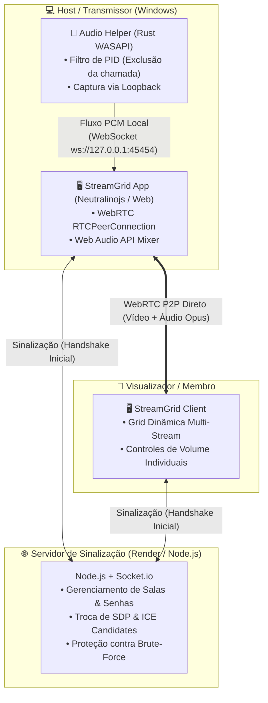

# 🖥️ StreamGrid — Multi-Screen Sharing over WebRTC

<p align="center">
  <a href="https://screenshare-p2p.onrender.com" target="_blank">
    
  </a>
</p>

<p align="center">
  <strong>Compartilhamento simultâneo de múltiplas telas em tempo real com isolamento de áudio por processo para Windows.</strong>
</p>

<p align="center">
  <a href="https://screenshare-p2p.onrender.com">
    
  </a>
  <a href="https://github.com/Pedrosasouza/screenshare-p2p/releases/latest">
    
  </a>
</p>

<p align="center">
  
  
  
  
  
</p>

---

## 📌 O que é o StreamGrid?

O **StreamGrid** é uma aplicação de compartilhamento de tela desenvolvida para permitir que múltiplos participantes transmitam suas telas simultaneamente, com os fluxos organizados em uma grade visual e controles de volume independentes.

Além da visualização em grade, o projeto aborda um desafio comum em transmissões entre amigos e equipes: a **captura do áudio do sistema sem retransmitir a própria chamada de voz**. Na versão Desktop para Windows, um módulo nativo permite selecionar processos específicos para incluir ou excluir da captura de áudio, evitando retorno de voz sem a necessidade de instalar drivers ou cabos de áudio virtuais.

> 🚀 **Experimente no navegador:** A versão web da aplicação está hospedada e disponível para testes em:  
> **👉 [https://screenshare-p2p.onrender.com](https://screenshare-p2p.onrender.com)**

---

## ⚖️ Versão Web vs. Versão Desktop

Devido às restrições de segurança e sandbox dos navegadores (`getDisplayMedia`), determinadas operações de baixo nível no subsistema de som do sistema operacional são exclusivas do aplicativo desktop.

| Recurso | Versão Web (Navegador) | Versão Desktop (Windows) |
| :--- | :---: | :---: |
| **Acesso Imediato sem Instalação** | ✅ Sim (Link direto no Render) | ⚙️ Requer download/compilação |
| **Visualização Multi-Telas em Grade** | ✅ Sim | ✅ Sim |
| **Transmissão de Vídeo em Alta Resolução** | ✅ Sim | ✅ Sim |
| **Áudio de Abas e Sistema Básico** | ✅ Sim (nativo do navegador) | ✅ Sim |
| **Exclusão de Processos (Ex: Chamada do Discord)** | ❌ *Indisponível no browser* | ✅ **Exclusivo Desktop (Rust WASAPI)** |
| **Captura Isolada por Janela / Jogo** | ❌ *Indisponível no browser* | ✅ **Exclusivo Desktop (Rust WASAPI)** |

> [!IMPORTANT]
> **Ressalva de Áudio:**  
> A captura do som do computador com **exclusão do áudio da chamada** e a **captura seletiva por processo (PID)** funcionam exclusivamente no **aplicativo Desktop para Windows**.  
> No navegador (versão Web), o compartilhamento de áudio fica condicionado às opções oferecidas pela API padrão do navegador (áudio da aba ou dispositivo geral).

---

## 🎯 Funcionalidades Principais

### 1. Visualização & Transmissão
* **Grade Dinâmica Multi-Stream:** Visualização de múltiplas transmissões simultâneas na mesma sala, adaptando o layout conforme novos membros iniciam ou encerram transmissões.
* **Controles por Transmissão:** Controle de volume individualizado para cada transmissão recebida, modo tela cheia e alternador de perfil de exibição.
* **Otimização de SDP:** Ajustes nos parâmetros de negociação de mídia do WebRTC (*Session Description Protocol*), incluindo configurações de áudio estéreo Opus e taxas de vídeo, para priorizar os perfis desejados de transmissão durante a sinalização.

### 2. Motor de Áudio Dedicado (Exclusivo Desktop / Rust)
* **WASAPI Loopback com Filtro por Processo:** Captura direta da sessão de áudio do Windows (`IAudioClient`), permitindo filtrar fluxos a partir do identificador de processo (PID).
* **Sem Dependência de Drivers Externos:** Não requer instalação ou configuração de softwares de cabos virtuais adicionais.
* **Ciclo de Vida Vinculado:** O assistente de áudio em segundo plano (`streamgrid-audio-helper.exe`) é acoplado ao ciclo da aplicação, com encerramento automático ao fechar a janela principal.

### 3. Gerenciamento de Salas & Segurança
* **Salas Públicas ou Privadas:** Criação por identificadores legíveis (`grid-xxxx-xxxx`) ou códigos customizados.
* **Proteção por Senha Opcional:** As senhas das salas privadas são armazenadas como hashes com salt no servidor.
* **Mitigação de Abusos:** Rate-limiting para proteção contra tentativas repetitivas de senha e sanitização de dados para prevenção de injeção de scripts (DOM XSS).

---

## 🏗️ Arquitetura do Sistema & Decisões Técnicas



### Justificativas de Projeto

1. **Topologia WebRTC P2P (Full Mesh) vs. Servidor de Mídia Central (SFU/MCU):**
   * *Motivação:* A topologia P2P direta evita a necessidade de um servidor central de mídia para retransmitir os fluxos de vídeo, reduzindo a infraestrutura de backend necessária para grupos pequenos e permitindo a comunicação direta entre os clientes.
2. **Módulo em Rust com WASAPI vs. Drivers Virtuais:**
   * *Motivação:* A escolha de Rust permite combinar controle de baixo nível de memória com a biblioteca `windows-rs` para interagir diretamente com as APIs de sessão de áudio do Windows (WASAPI Loopback), viabilizando o filtro por processo sem depender de drivers de terceiros.
3. **Neutralinojs vs. Electron:**
   * *Motivação:* O Neutralinojs reaproveita o motor webview nativo já existente no sistema operacional (Edge WebView2 no Windows), reduzindo o tamanho final de distribuição e o consumo de recursos quando comparado ao empacotamento de um runtime Chromium dedicado.

---

## 💻 Como Executar Localmente

### Pré-requisitos
* [Node.js](https://nodejs.org/) (versão 18 ou superior)
* [Rust & Cargo](https://rustup.rs/) *(apenas se for recompilar o assistente de áudio a partir do código-fonte)*

### 1. Execução do Servidor Web
```bash
# Clonar o repositório
git clone https://github.com/Pedrosasouza/screenshare-p2p.git
cd screenshare-p2p

# Instalar dependências
npm install

# Iniciar servidor local
npm start
```

Acesse a interface no navegador em: `http://localhost:3000` (ou pelo endereço de IP local exibido no terminal).

---

## 📥 Download da Versão Desktop (Windows)

As versões oficiais pré-compiladas para Windows estão disponíveis diretamente na página de lançamentos:
* **Última Versão:** [GitHub Releases — StreamGrid](https://github.com/Pedrosasouza/screenshare-p2p/releases/latest)
* **Arquivo Portátil:** Baixe o arquivo `StreamGrid-Windows.zip`, extraia em uma pasta de sua preferência e execute `StreamGrid-win_x64.exe`.
* **Verificação de Integridade:** Cada versão inclui o arquivo `StreamGrid-Windows.zip.sha256` para conferência de hash SHA-256 (validação de integridade do arquivo baixado contra corrupção em trânsito).
* **Aviso do Windows SmartScreen & Assinatura de Código:** Por ser um projeto open-source independente distribuído sem um certificado de assinatura Authenticode comercial pago da Microsoft, o Windows SmartScreen pode apresentar o aviso informativo *"O Windows protegeu o seu computador - Fornecedor desconhecido"*. Para abrir normalmente, clique em *"Mais informações"* e em seguida em *"Executar assim mesmo"*. Todos os pacotes são compilados publicamente a partir do código-fonte auditável via GitHub Actions com atestação de proveniência criptográfica.

---

## 📦 Compilação Manual a partir do Código-Fonte (Windows)

Se preferir compilar localmente em vez de baixar o executável pré-compilado:

```bash
npm run build-windows
```

O artefato gerado estará em `dist/StreamGrid-Windows.zip`.

---

## 🧪 Bateria de Testes

O repositório inclui testes automatizados para verificar a robustez da sinalização e regras de segurança:

```bash
npm test
```

A suíte padrão executa:
* **Fuzzing & Resiliência:** Avalia a estabilidade do servidor diante de mensagens WebSocket com formatos inesperados ou incompletos (`test/fuzz-crash-test.js`).
* **Otimização de SDP:** Valida a substituição correta de parâmetros para negociação de áudio e vídeo no WebRTC (`test/sdp-optimization.test.js`).
* **Rate Limiting:** Testa o bloqueio temporário após tentativas consecutivas incorretas de senha (`test/ip-rate-limit.test.js`).

Para validar especificamente o ciclo de vida e a persistência de tokens do assistente de áudio no Windows:
```bash
npm run test:helper
```

---

## 🔒 Segurança & Privacidade

* **Criptografia de Mídia (DTLS/SRTP) e Canal de Sinalização:** Os fluxos de áudio e vídeo trafegam diretamente entre os participantes (P2P Mesh) protegidos por DTLS 1.2/1.3 e SRTP, sem decodificação por servidores de mídia centrais (SFU/MCU). Conforme detalhado em [PRIVACY.md](PRIVACY.md), a segurança do handshake inicial de chaves depende da integridade do canal de sinalização (HTTPS/WSS com o servidor), uma vez que o sistema não implementa verificação out-of-band de certificados entre os membros.
* **Política de Privacidade & Retenção de Dados:** Consulte [PRIVACY.md](PRIVACY.md) para detalhes completos sobre o ciclo de vida dos dados em memória volátil, a visibilidade mútua de endereços IP entre membros de uma sala (necessária para negociação ICE no WebRTC P2P) e logs temporários de infraestrutura de borda (Render).
* **Integridade dos Binários & Proveniência:** Todos os pacotes de lançamento para Windows são compilados de forma automatizada e auditável via GitHub Actions em runners isolados, acompanhados de somas de verificação SHA-256 e atestados de proveniência criptográfica gerados via Sigstore (*GitHub Artifact Attestations*).

---

## 👤 Autor

Desenvolvido por **Pedro Souza**  
* GitHub: [@Pedrosasouza](https://github.com/Pedrosasouza)  
* Portfólio: [Pedrosasouza.github.io](https://Pedrosasouza.github.io)

---

## 📄 Licença

Este projeto está licenciado sob os termos da licença [MIT](LICENSE).
